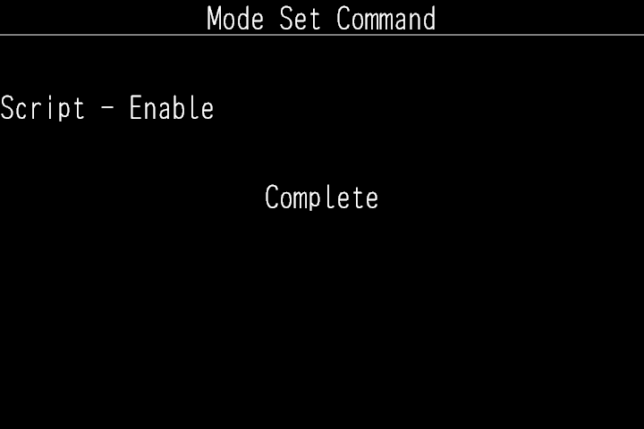

# GRKit

For RICOH GR IV and GR IV HDF firmware 1.11 only.

GRKit for GR IV is experimental and has not been tested on a camera. Use it only if you accept that risk.

## Install

1. Turn the camera off.
2. Copy the contents of `SD_ROOT` to the root of the SD card.
3. Insert the card. Hold MENU while you turn the camera on. Wait until the camera turns itself off.
4. Turn the camera on normally.

Step 3 turns on the camera's SD scripts. The camera shows Mode Set Command, then Complete, and then turns itself off.

If the SD scripts are already on, skip step 3.
After the installation, you can remove `00078560.636` and `DEVELOP.MOD` from the card root. This step is optional.

## Use

Open ADJ and select the sixth entry, GRK. GRKit loads a few seconds after power-on, so the entry can appear late.

- **Image Control:** highlight an effect to preview it. Press OK to keep it. Press Fn to adjust the Standard parameters of the effect. Each effect keeps its own adjustments, and they do not change the camera's Image Control settings. The effects were made for GR III, so their colors can differ on GR IV.
- **Framing:** select XPan. The viewfinder stays 3:2 and dims the area outside the photo. XPan also works when the native aspect ratio is 16:9.
- **Guides:** select a guide style. The lines show only in the viewfinder.
- **Date Stamp:** select a date style. Photos get the date at the bottom right.
- **Grain:** select Weak, Medium, or Strong. Only photos get the grain.

Highlight the last row, GRK, to see the GRKit version.

Press MENU to go back one level. GRKit keeps your settings after power-off.

## Remove or recover

To remove GRKit, turn the camera off. Then delete the `SCRIPT` folder from the card.

If the camera stops during startup, remove the battery and the card. Then start the camera without the card. If it still does not start, see the [recovery guide](https://github.com/ahonn/grkit/blob/main/resources/RECOVERY.md).

GRKit is not affiliated with Ricoh. Source code and licenses: https://github.com/ahonn/grkit
